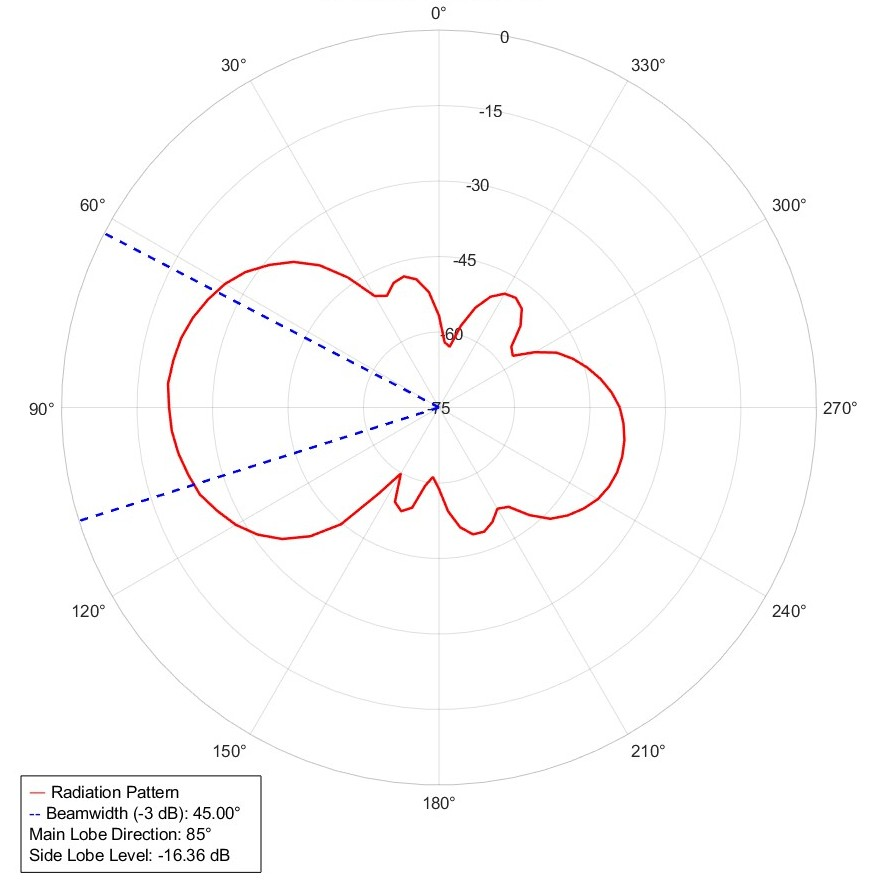
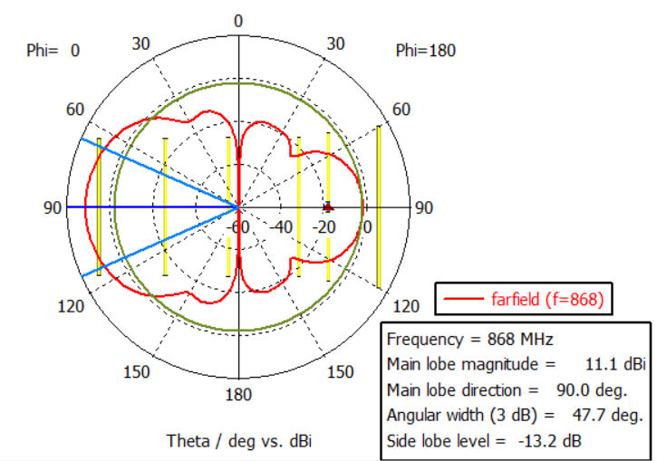
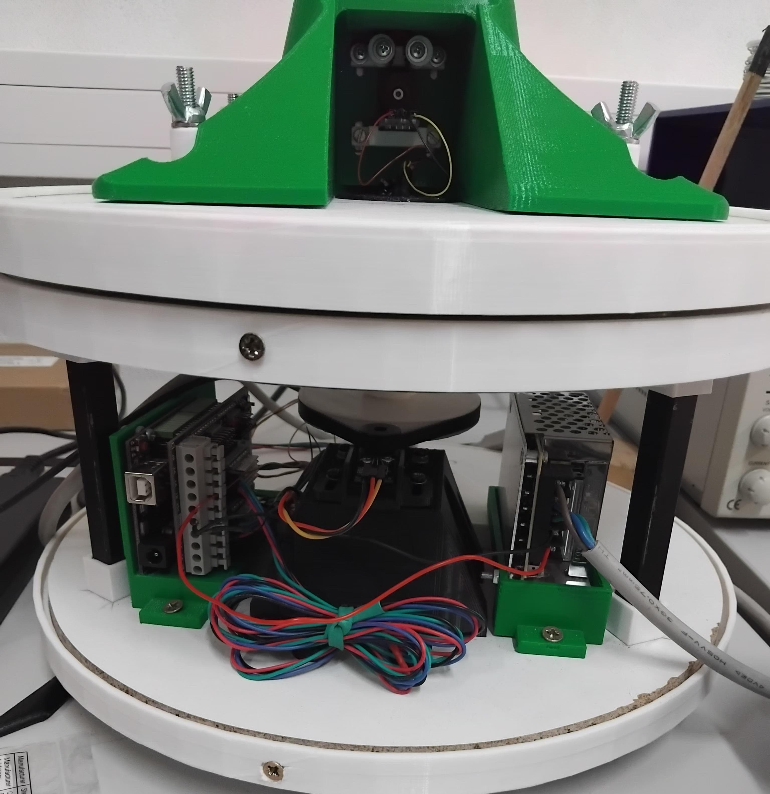
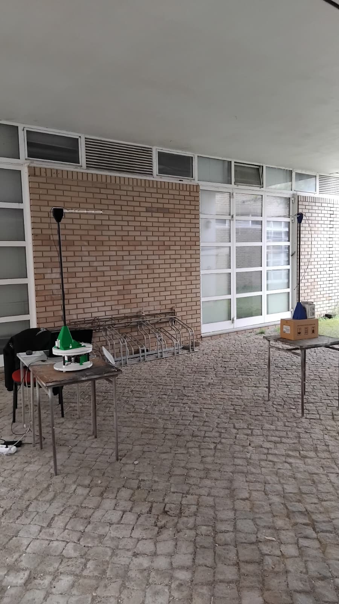

# Two-Axis Computerised Antenna Radiation Pattern Measurement System

A low-cost, two-axis rotating platform that measures the radiation pattern of an antenna at **868 MHz** (ISM band). It was built as the final project of the BSc in Electrical and Computer Engineering (LEEC) at the Polytechnic Institute of Bragança (IPB), 2024-2025.

An Arduino Uno drives two NEMA 17 stepper motors. An **AD8313** logarithmic detector reads the received RF power, and MATLAB commands each step and plots the result. The system was validated with a pair of home-made 6-element Yagi-Uda antennas, and the measurements were compared with CST Studio Suite simulations.

This repository holds **the whole project, development phase included**: firmware, MATLAB scripts, raw measurement data from every test campaign, VNA characterisation of the antennas, filter, balun and matching PCB, the CST/NEC simulation models, the SolidWorks/STL files for 3D printing, photos, videos, the report sources and the published papers.

| Measured (complete system) | CST simulation |
|---|---|
|  |  |

| The system | Outdoor measurement set-up |
|---|---|
|  |  |

---

## Key results

| Parameter | Measured | Simulated (CST) |
|---|---|---|
| Main lobe direction | 90° | 90° |
| Half-power beamwidth (−3 dB) | 49.1° | 53.5° |
| Front-to-back ratio | 17.0 dB | 16.3 dB |
| Antenna S11 at 868 MHz, no matching | ≈ −10 dB (VSWR 1.9, Z ≈ 30 + j0.7 Ω) | — |
| S11 with the matching PCB | **−20.3 dB** (VSWR 1.21, Z = 43.1 − j5.76 Ω) | — |
| Balun: differential-mode loss / common-mode rejection | −0.58 dB / > 47 dB | — |
| SAW band-pass filter insertion loss | ≈ 3 dB (−3 dB band 860-880 MHz) | — |
| Received power at 2.5 m (Friis estimate −22 dBm) | −21 to −18 dBm | — |

The reflected power dropped from **7.9 % to 0.92 %** once the matching network was added. All measurements were taken outdoors (there was no anechoic chamber), with both antennas 1 m above the ground and 2.5 m apart. The far-field limit for this antenna is ≈ 0.52 m.

---

## How it works

```
 MATLAB (PC)  ──USB/UART 115200──►  Arduino Uno + dual DRV8825 shield
     ▲   "θ,φ"  command                    │  STEP/DIR (1/16 µstep)
     │                                     ▼
     │                          NEMA 17 (azimuth)  +  NEMA 17 (2nd axis)
     │                          belt + 3D-printed pulleys, Hall homing
     │   100 samples in dBm                │
     └─────────────────────────────  AD8313 detector ◄── Yagi RX (DUT)
                                                           ▲ 868 MHz
                     Signal generator ── filter ── Yagi TX ┘ (2.5 m)
```

1. MATLAB opens the serial port and waits for `Ready?`, then sends `Set.`.
2. The Arduino homes each axis on a magnet + Hall sensor (KY-035) and answers `Go.`.
3. For every angle, MATLAB sends `"<θ>,<φ>"`. The Arduino moves, waits 0.9 s for the mast to settle, takes 100 ADC samples over 0.1 s of the AD8313, converts them to dBm and sends them back as CSV.
4. MATLAB averages the samples and draws the polar plot.

To stop the coaxial cable from twisting, the azimuth axis sweeps **0 → +180°, goes back to 0, then sweeps 0 → −180°**, in 5° steps (72 points).

## Hardware

| Part | Notes |
|---|---|
| Arduino Uno R3 (ATmega328P) | Controller |
| DFRobot dual bipolar stepper shield (DRI0023) with 2× DRV8825 | 1/16 microstepping, 12 V |
| 2× NEMA 17 (1.8°/step) | Belt and pulley drive (36T / 72T / 126T 3D-printed pulleys) |
| AD8313 detector module, 0.1-2.5 GHz | ~18 mV/dBm (measured 18.5 mV/dBm) → A3 |
| 2× Hall sensor KY-035 (49E) | Homing → A0, A1 |
| 12 V / 2 A PSU (Orno OR-ZL-1631) | |
| 868 MHz SAW band-pass filter | |
| RG-174 air-choke balun (home-made) | [hardware/balun](hardware/balun) |
| L-section matching PCB (CNC-milled) | [hardware/impedance-matching](hardware/impedance-matching) |
| 2× 6-element Yagi-Uda, 3 mm brass rods, PLA boom | TX and RX |
| 1 m fibreglass mast, PLA parts, wooden base | Non-metallic near the antenna |

Pinout: J1 (azimuth) STEP 6 / DIR 7 / EN 8 / Hall A0 · J2 STEP 5 / DIR 4 / EN 12 / Hall A1 · RF A3. The schematics are in [hardware/electronics](hardware/electronics).

Yagi-Uda element lengths and positions (from CST; position measured from the driven-element centre):

| Element | Length (mm) | Position (mm) |
|---|---|---|
| Reflector | 166.41 | −51.964 |
| Driven | 150.98 | 0 |
| Director 1 | 143.85 | 30.104 |
| Director 2 | 142.16 | 102.131 |
| Director 3 | 140.48 | 166.814 |
| Director 4 | 139.51 | 234.902 |

---

## Repository layout

| Folder | Contents |
|---|---|
| [`firmware/main`](firmware/main) | Arduino sketch (`main.ino`) and the `Joint` stepper class (`joint.h/.cpp`) |
| [`firmware/development`](firmware/development) | Early sketches used to test the AD8313 (April 2025) |
| [`matlab/acquisition`](matlab/acquisition) | `ArduinoCommunication.m`: drives the platform and plots the pattern |
| [`matlab/analysis`](matlab/analysis) | `plot_das_medidas.m`: polar plot with HPBW, main-lobe direction and side-lobe level |
| [`matlab/balun`](matlab/balun) | `code_balun.m`: number of turns for the RG-174 choke balun |
| [`matlab/development`](matlab/development) | First serial test script and data |
| [`python/deembedding`](python/deembedding) | Removes the coaxial cable from the antenna S11 measurement |
| [`measurements`](measurements) | **Every test campaign, raw data and figures**, in chronological order |
| [`hardware`](hardware) | Electronics, impedance-matching PCB, balun, filter, **CAD (SolidWorks + STL)** |
| [`simulation`](simulation) | CST Studio Suite projects, 4NEC2 model, simulation figures |
| [`docs`](docs) | Final report (LaTeX source), project proposal, SASYR 2025 and TEEM 2025 papers, poster, defence slides |
| [`media`](media) | Photos and videos of the system and the tests (videos are stored with Git LFS) |

## Running a measurement

1. Flash `firmware/main/main.ino` with the Arduino IDE (the board must be an Arduino Uno).
2. Power the shield with 12 V and connect the AD8313 output to A3.
3. In MATLAB (with the Instrument Control Toolbox), run `matlab/acquisition/ArduinoCommunication.m`. The script uses the first available COM port.
4. After the sweep you get a polar plot of the pattern. To get the beamwidth and side-lobe level, put the averaged vector in a variable `media` and run `matlab/analysis/plot_das_medidas.m`.

## Project status and known issues

This is the code exactly as it was used for the report. Some things were never finished:

- **The 3D (two-axis) measurement was never completed in software.** The firmware already accepts `θ,φ` commands, but in `main.ino` the homing of joint 2 is commented out, and the MATLAB script uses `phi = 0:0` (azimuth only). The script that produced the measured 3D figure in the report (Fig. 4.10, images in [`measurements/2025-08-22_full-system_2d-and-3d`](measurements/2025-08-22_full-system_2d-and-3d)) is not in the project files, and no raw 3D data matrix was kept.
- **The AD8313 calibration in the firmware and in the report differ.** The firmware uses `P[dBm] = 0.2722·ADC − 97.115`. The report's least-squares fit (eq. 4.3, `Vout = 0.0185·Pin + 1.8621`) gives about `0.2642·ADC − 100.65` with a 5 V reference. The ~3.5 dB offset shifts the absolute level but not the normalised pattern.
- The step-to-degree factors are hard-coded: `joint1` 56 µsteps/degree, `joint2` 16 µsteps/degree.

### Roadmap

- [ ] One MATLAB entry point with two modes: **2D** (fast azimuth cut) and **3D** (full θ-φ grid, slower)
- [ ] Finish the joint-2 homing and validate the elevation axis
- [ ] Single calibration constant shared by firmware and report
- [ ] A graphical interface (MATLAB App) instead of Command Window output

## Publications

- M. S. Leme, J. A. B. Coelho, J. P. Coelho, *"Development of a 2-DoF Antenna Radiation Measurement System"*, SASYR 2025. [Paper](docs/papers/sasyr-2025) · [Poster](docs/papers/sasyr-2025/poster)
- M. S. Leme, J. A. B. Coelho, J. P. Coelho, *"Two-Axis Computerised Antenna Radiation Pattern Measurement System"*, TEEM 2025 (revised version). [Paper](docs/papers/teem-2025)
- M. S. Leme, *"Two-Axis Computerised Antenna Radiation Pattern Measurement System"*, LEEC project report, IPB, 2025. Supervisor: Prof. Dr. João Paulo Coelho. [LaTeX source](docs/report/latex)

## Acknowledgements

Supervisor Prof. Dr. João Paulo Coelho. João Alexandre Batista Coelho, Mariano Alvarez and Laiany Suganuma Brancalião, for their support. Prof. José Alexandre de Carvalho Gonçalves, for access to the IPB laboratories. CeDRI and ESTiG, and MORE CoLAB (Higor Rosse) for producing the PCBs.

This work was supported by national funds: UID/05757 - Research Centre in Digitalization and Intelligent Robotics (CeDRI), and SusTEC, LA/P/0007/2020 (DOI: 10.54499/LA/P/0007/2020).

## License

The code is released under the [MIT License](LICENSE). The papers in `docs/papers` keep the copyright of their respective publishers.
