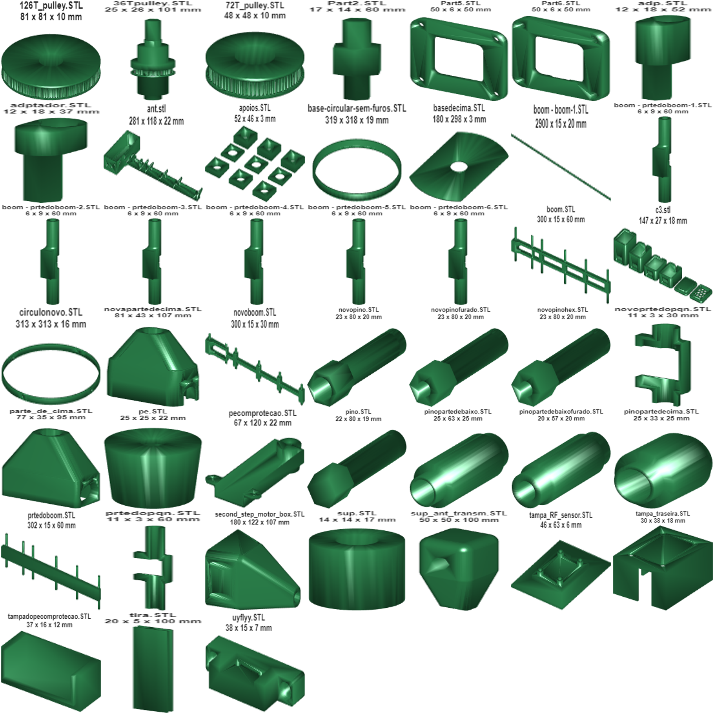

# Mechanical CAD

Designed in SolidWorks (educational licence, IPB) and printed in PLA on a Creality Ender-5 Pro. The **file names are the original working names** (Portuguese, sometimes abbreviated). Several parts exist in more than one iteration (`pino` → `novopino` → `novopinofurado` / `novopinohex`; `boom` → `novoboom`), and all iterations are kept.

*(One preview per STL is in [`previews/`](previews), generated with MATLAB `stlread`.)*

| Folder | Contents |
|---|---|
| [`solidworks`](solidworks) | `.SLDPRT` / `.SLDASM` sources (`Assem1258.SLDASM`, antenna `ant.SLDPRT`, boom, pins, pulley, `quadra_interior`…) |
| [`solidworks/balun-support`](solidworks/balun-support) | Balun former/support versions (`Ver1a…Ver3b`), RG-174 model, assembly |
| [`stl`](stl) | Printable meshes |
| [`images`](images) | SolidWorks renders used in the report |
| `CST_Studio_suite_Yagi-Uda_868MHz_3Dprint.pdf` | Print of the antenna geometry used for the boom |

## Parts

The grouping below was inferred from file names and shapes.

| Group | Files | Notes |
|---|---|---|
| Belt drive | `36Tpulley`, `72T_pulley`, `126T_pulley` | Timing pulleys; the bigger pulley on the motor was the fix for antenna oscillation (more torque, slower motion) |
| Base | `base-circular-sem-furos` (319 Ø), `circulonovo` (313 Ø), `basedecima`, `apoios`, `pe`, `pecomprotecao`, `tampadopecomprotecao` | Circular turntable rings, top plate, feet/supports |
| Second axis | `second_step_motor_box` (180×122×107), `parte_de_cima`, `novapartedecima` | Housing for the 2nd NEMA 17 at the top of the mast |
| Mast and pins | `pino`, `novopino`, `novopinofurado`, `novopinohex`, `pinopartedecima`, `pinopartedebaixo`, `pinopartedebaixofurado`, `adp`, `adptador`, `sup` | Couplings between the fibreglass tube, the pulleys and the antenna mount |
| Antenna boom | `boom`, `novoboom`, `prtedoboom`, `boom - prtedoboom-1…6`, `prtedopqn`, `novoprtedopqn`, `ant.stl` | PLA boom of the Yagi-Uda and the element clips. ⚠️ `boom - boom-1` exports at 2900 mm long, so check the units before printing |
| TX antenna mount | `sup_ant_transm` | Support of the fixed transmitting antenna |
| Enclosures | `tampa_RF_sensor`, `tampa_traseira`, `Part5`, `Part6`, `c3` | AD8313 module cover, rear cover, frames, a print plate of small boxes |
| Misc | `Part2`, `tira`, `uyflyy` | Small adapters/test prints |

The 3D-printing G-code (Ender-5 Pro, `CE5P_*.gcode`) is not included because it only works on that printer. Slice the STL files for your own machine.
