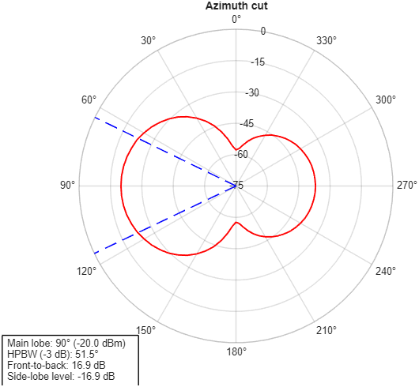
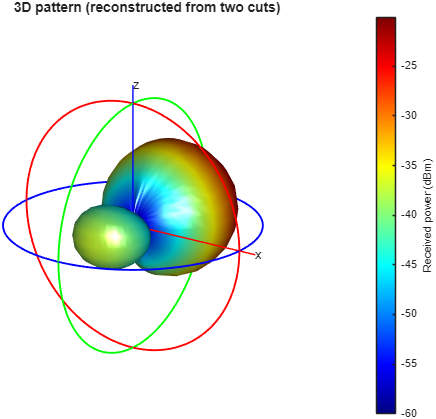
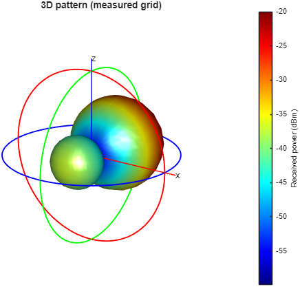

# MATLAB

## Quick start

| I want to… | Run |
|---|---|
| Measure with the platform | `RadiationPatternMeasurement.m` (edit the *Settings* block first) |
| Try everything **without hardware** | same script with `cfg.simulate = true` |
| Re-plot a saved scan or a lab spreadsheet | `PlotSavedMeasurement.m` |

All the logic is in the `+rpm` package (`rpm.run`, `rpm.plot2D`, …), and only base MATLAB is needed: `serialport` is built in since R2019b and no toolbox is required.

## Modes

| `cfg.mode` | What the platform does | Positions (5° az, 5° el) | Est. time* |
|---|---|---|---|
| `"2D"` | Azimuth cut at el = 0, the same as in the report | 72 | ~6 min |
| `"3D-slices"` | Azimuth cut, then a second-axis cut through the main lobe. The 3D surface is **reconstructed** from the two cuts (summing method) | 109 | ~9.5 min |
| `"3D-grid"` | Axis 2 steps 5° (−90° → +90°) and a **full azimuth sweep is repeated at each step**, so the whole sphere is measured point by point. Rows alternate direction (serpentine), so the cable never passes ±180° | 2664 | ~3 h |

\*Estimated from the firmware timing (10 ms per micro-step, 56 µsteps/° on axis 1, 16 µsteps/° on axis 2, 1 s settling per position). The script prints the estimate before it starts. With `cfg.elStep = 10` the grid drops to 1368 positions (~1.5 h).

`cfg.secondAxis` says how axis B is mounted. Use `"elevation"` if it tilts the antenna up and down, or `"roll"` if it spins the antenna about its boresight, in which case each azimuth sweep becomes a rotated great-circle cut. This only changes how angles map to 3D space. `3D-slices` needs `"elevation"`.

⚠️ **The 3D modes need axis 2 homed.** Set `#define HOME_JOINT2 1` in `firmware/main/main.ino`, which requires the magnet and Hall sensor on axis 2. Otherwise axis 2 starts wherever it was left (align it by hand to 0°). Also check `cfg.elRange` against the mechanics and the cable before the first run.

## Output

Every scan is saved to `matlab/results/<yyyyMMdd_HHmmss>_<mode>.mat` (config, raw samples) and `.csv` (`scan, az_deg, el_deg, mean_dBm, std_dB`). The 2D plot reports the main-lobe direction, HPBW (interpolated at −3 dB), front-to-back ratio and side-lobe level.

## Other folders

| Folder | Contents |
|---|---|
| `analysis/plot_das_medidas.m` | The original post-processing script used for the report figures |
| `balun/code_balun.m` | Choke balun turns vs inductance (report appendix E) |
| `legacy/ArduinoCommunication.m` | The original acquisition script (azimuth only). Appendix A of the report prints a slightly different revision (+270° display rotation, no partial inversion), kept in `docs/report/latex/codes/` |
| `development/` | First serial test (April 2025) |

## What the plots look like (simulator)

These come from `cfg.simulate = true`, a software model of an idealised directional antenna. **They are not measurements**: no 3D data was taken during the project.

| 2D | 3D-slices (reconstructed) | 3D-grid |
|---|---|---|
|  |  |  |
