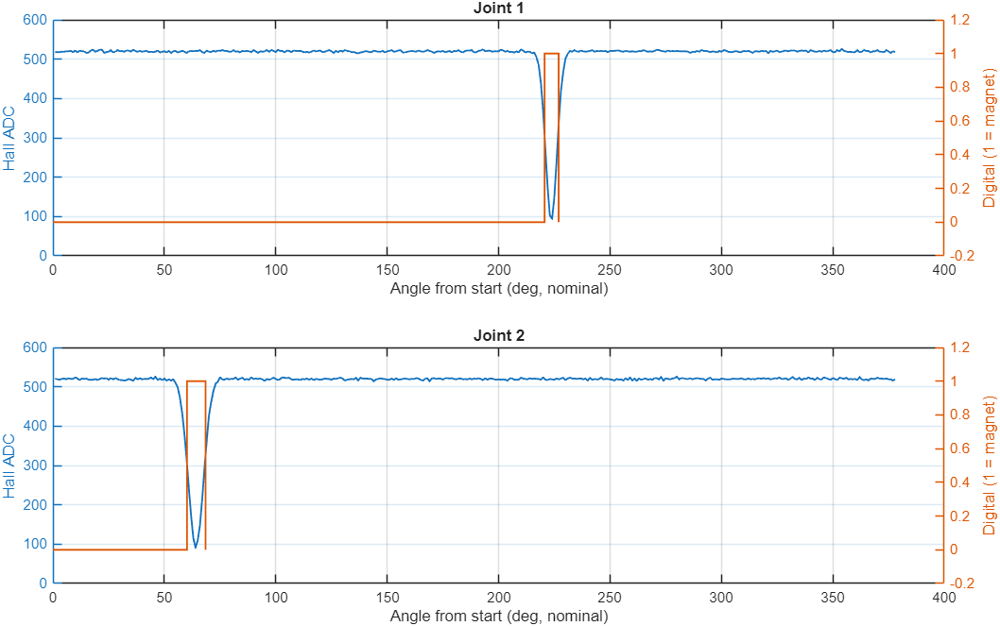
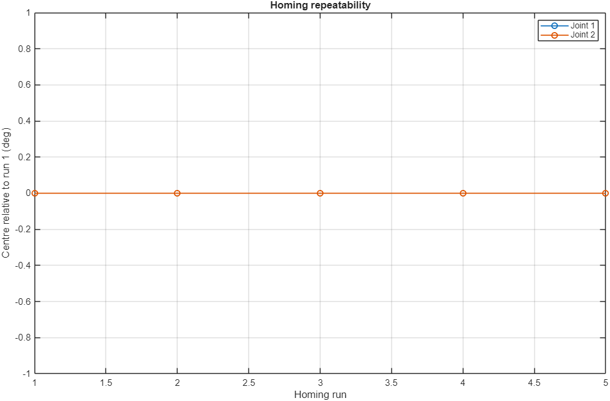
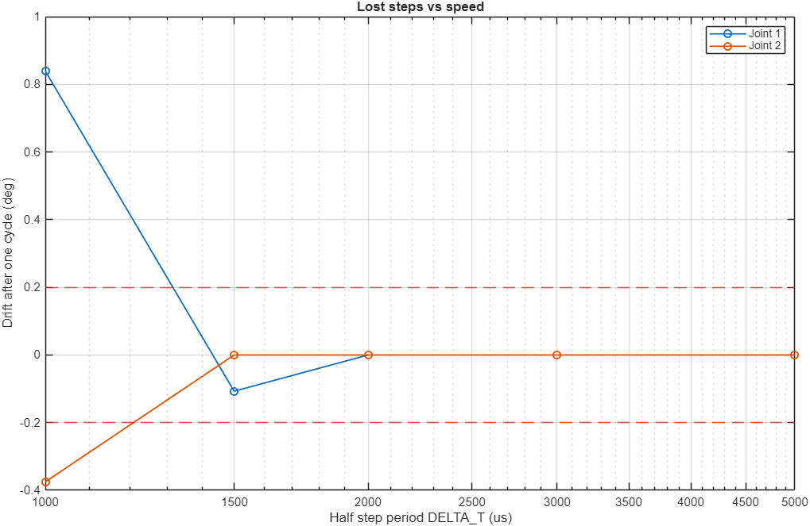
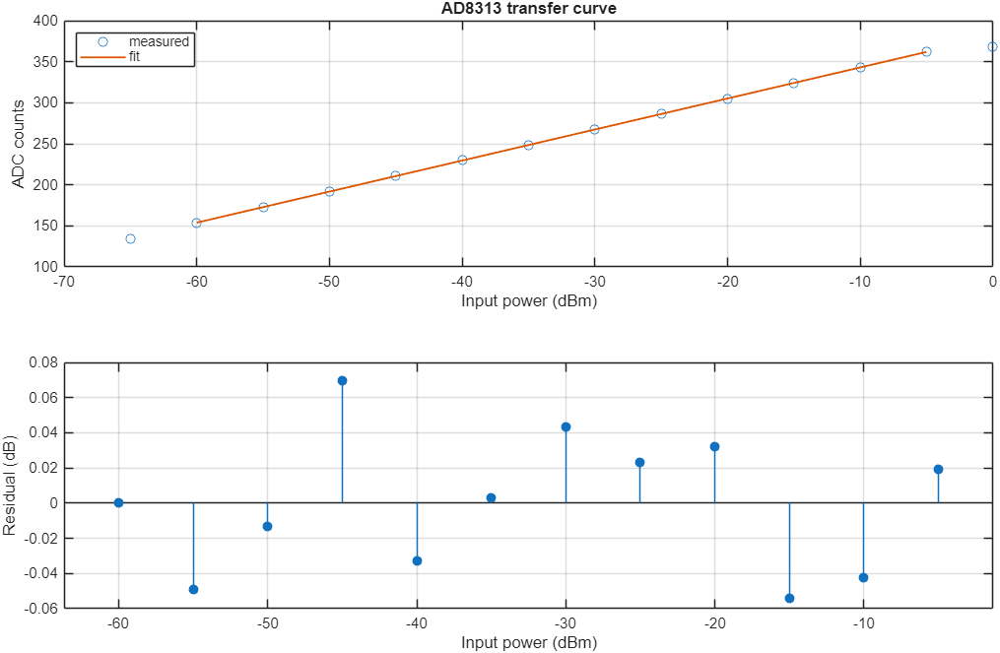
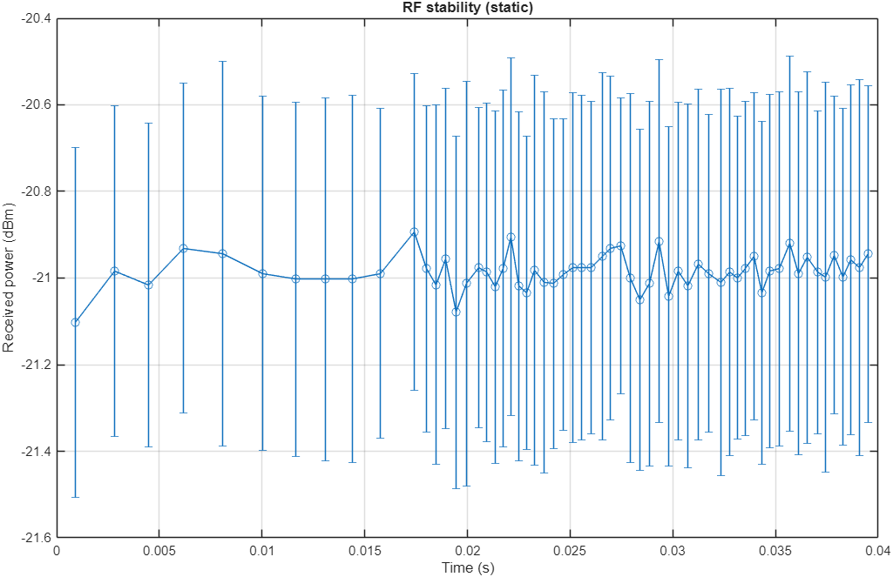

# Commissioning report

- Date: 2026-10-10 11:28
- **SIMULATED RUN** (SimulatedRig, faults injected on purpose). Not a hardware result.
- Joints tested: [1 2] | firmware usteps/deg: [56 16] | DELTA_T: 5000 us

| Test | Result | Time |
|---|---|---|
| T01 Communication and sensors | **PASS** | 0 s |
| T02 Hall sensor profile (one turn per joint) | **PASS** | 1 s |
| T03 Steps per degree (calibration) | **FAIL** | 0 s |
| T04 Backlash + Hall hysteresis (forward vs backward) | **PASS** | 0 s |
| T05 Homing repeatability | **PASS** | 0 s |
| T06 Lost steps in the measurement cycle vs speed | **PASS** | 0 s |
| T07 Position held with the driver off (sleep timeout) | **FAIL** | 0 s |
| T08 AD8313 calibration (ADC -> dBm) | **PASS** | 0 s |
| T09 RF reading stability | **PASS** | 0 s |

## T01 Communication and sensors: PASS

- Firmware: INFO,commissioning-sim,5000
- PING x20: median 0.0 ms, max 3.0 ms
- Hall now: J1 0 (ADC 519), J2 0 (ADC 522)

## T02 Hall sensor profile (one turn per joint): PASS

- J1: 1 magnet window(s) per turn (OK) | width 6.3 deg | analog idle 520, at magnet 94 (ADC)
- J2: 1 magnet window(s) per turn (OK) | width 8.3 deg | analog idle 520, at magnet 91 (ADC)

## T03 Steps per degree (calibration): FAIL

- J1: 20196 usteps/turn (spread 0) -> 56.100 usteps/deg | firmware uses 56 -> error +0.64 deg/turn (TOO BIG) | best integer 56 (error +0.64 deg/turn)
- J1: no integer usteps/deg is accurate enough. firmware/main stores steps_per_degree as uint16_t; convert in Joint::RotateMotor with usteps per TURN (20196) instead: steps = target_deg * 20196 / 360.
- J2: 5760 usteps/turn (spread 0) -> 16.000 usteps/deg | firmware uses 16 -> error +0.00 deg/turn (OK) | best integer 16 (error +0.00 deg/turn)
- Note: an integer value per degree can only be exact if usteps/turn is a multiple of 360.

## T04 Backlash + Hall hysteresis (forward vs backward): PASS

- J1: backlash + hysteresis 0.82 deg (min 0.82, max 0.82, n=5) (OK)
- J2: backlash + hysteresis 0.69 deg (min 0.69, max 0.69, n=5) (OK)

## T05 Homing repeatability: PASS

- J1: homing spread 0.000 deg (std 0.000, n=5) (OK)
- J2: homing spread 0.000 deg (std 0.000, n=5) (OK)

## T06 Lost steps in the measurement cycle vs speed: PASS

- J1: DT =  5000 us (50.4 s per 90 deg) -> drift +0.00 deg (OK)
- J1: DT =  3000 us (30.2 s per 90 deg) -> drift +0.00 deg (OK)
- J1: DT =  2000 us (20.2 s per 90 deg) -> drift +0.00 deg (OK)
- J1: DT =  1500 us (15.1 s per 90 deg) -> drift -0.11 deg (OK)
- J1: DT =  1000 us (10.1 s per 90 deg) -> drift +0.84 deg (LOST STEPS)
- J1: fastest setting without lost steps: DELTA_T = 1500 us
- J2: DT =  5000 us (14.4 s per 90 deg) -> drift +0.00 deg (OK)
- J2: DT =  3000 us (8.6 s per 90 deg) -> drift +0.00 deg (OK)
- J2: DT =  2000 us (5.8 s per 90 deg) -> drift +0.00 deg (OK)
- J2: DT =  1500 us (4.3 s per 90 deg) -> drift +0.00 deg (OK)
- J2: DT =  1000 us (2.9 s per 90 deg) -> drift -0.38 deg (LOST STEPS)
- J2: fastest setting without lost steps: DELTA_T = 1500 us

## T07 Position held with the driver off (sleep timeout): FAIL

- J1: 30 s off at +45 deg -> shift +0.00 deg (OK)
- J2: 30 s off at +45 deg -> shift +1.19 deg (POSITION LOST)
- Fix: keep the drivers enabled during a scan (raise MOTOR_SLEEP_TIMEOUT in joint.h) or re-home axis 2 before each row.

## T08 AD8313 calibration (ADC -> dBm): PASS

- Fit over -60..-5 dBm (12 points): power_dBm = 0.2644 * ADC -100.695
- Slope 18.49 mV/dB (datasheet ~18-19 mV/dB) | max residual 0.07 dB | ADC noise 1.5 LSB
- Firmware now: 0.2722 * ADC - 97.115 -> reads +5.68 dB off at a true -30 dBm
- Paste into main.ino capture_sensor_data(): power_dBm = raw * 0.2644 + (-100.695);

## T09 RF reading stability: PASS

- 60 readings over 0 s: mean -20.99 dBm
- Noise within one reading: 0.40 dB rms | drift of the means: 0.21 dB
- Averaging 100 samples gives an uncertainty of about 0.040 dB per point

## Values to carry into firmware/main

- `SetStepsPerDegree`: use T03 *best integer* per joint (main.ino setup()).
- `DELTA_T` (joint.h): the fastest T06 setting without lost steps, with some margin.
- RF conversion in `capture_sensor_data()`: the T08 line `power_dBm = raw * A + B`.
- If T07 failed: raise `MOTOR_SLEEP_TIMEOUT` so the drivers stay on during a scan.
